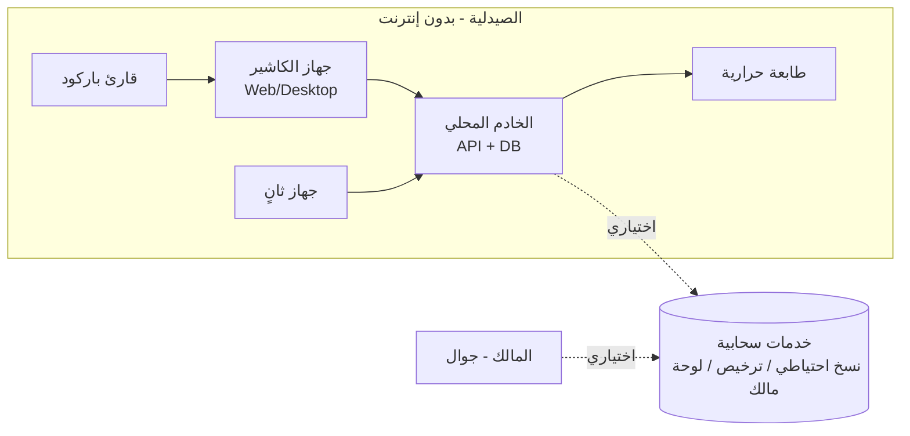

# SRS — مواصفات متطلبات البرمجيات
## PharmaCore — منصة إدارة الصيدليات

| البند | القيمة |
|---|---|
| المعيار | ISO/IEC/IEEE 29148:2018 (هيكل SRS) + صياغة EARS |
| الإصدار | 0.1.0 — مسودة للمراجعة |
| التاريخ | 2026-11-03 |
| الحالة | **Draft** — بانتظار تأكيد العميل (المرحلة 0) واعتماد الفريق |
| المالك | معين (المنسق التقني) |
| المصادر | `docs/00-handoff/TEAM-CHAT-ANALYSIS.md`, `docs/01-research/*` |

> **كيف تقرأ المتطلبات:** كل متطلب له معرّف فريد، أولوية MoSCoW (Must/Should/Could/Won't-now)، مصدر (CH-xx من المحادثات أو Rx من البحث)، ونطاق إصدار (MVP / v1.1 / v2). الصياغة بنمط EARS:
> `WHEN <حدث> THE SYSTEM SHALL <استجابة>` · `WHILE <حالة>` · `IF <شرط> THEN` · `WHERE <ميزة مفعّلة>`.

---

# 1. المقدمة

## 1.1 الغرض
تحديد المتطلبات الوظيفية وغير الوظيفية لمنصة **PharmaCore** لإدارة الصيدليات، بحيث تكون مرجعاً واحداً للفريق والعميل وأي وكيل تطوير، وأساساً للتصميم والاختبار والقبول.

## 1.2 النطاق
- **المنتج:** نظام متكامل لإدارة صيدلية (أصناف، مخزون بالدفعات، مبيعات/POS، مشتريات، محاسبة قيد مزدوج، جرد، تقارير، مستخدمين، ترخيص) يعمل **محلياً بدون إنترنت**، بواجهة عربية RTL، كويب + ديسكتوب (+ موبايل لاحقاً) من نواة واحدة، مصمم **متعدد المستأجرين** للبيع لصيدليات متعددة بباقات.
- **داخل نطاق MVP:** ما هو مُعلّم `MVP`.
- **خارج النطاق الحالي (Won't-now):** الوصفات الطبية الإلكترونية، التأمين الصحي، الموارد البشرية/الرواتب، التصنيع، التجارة الإلكترونية، الفوترة الضريبية الإلكترونية الرسمية (تُصمم البنية لاستقبالها).

## 1.3 المصطلحات (Ubiquitous Language مختصر — الكامل في `docs/03-domain/GLOSSARY.md`)
| المصطلح | التعريف |
|---|---|
| **الصنف (Item)** | منتج قابل للبيع (دواء/مستلزم) بتعريف واحد بغض النظر عن الدفعات |
| **الدفعة (Lot)** | كمية من صنف وصلت في استلام واحد بتاريخ انتهاء وتكلفة محددين |
| **أصغر وحدة بيع (SSU)** | الوحدة التي يُحسب بها المخزون (مثلاً: حبة) |
| **الوحدة (Unit)** | مستوى تعبئة (علبة/شريط/حبة) بمعامل تحويل إلى SSU |
| **الحركة (Stock Movement)** | صف غير قابل للتعديل يمثل تغيّر كمية (±) في دفعة بموقع |
| **المستند (Document)** | فاتورة بيع/شراء/مرتجع/جرد/تحويل له دورة حياة Draft → Posted |
| **الترحيل (Posting)** | تثبيت المستند وإنشاء حركاته وقيوده؛ بعده لا تعديل |
| **القيد (Journal Entry)** | قيد محاسبي مزدوج متوازن |
| **الوردية (Shift)** | فترة عمل كاشير تُفتح وتُقفل بمطابقة نقدية |
| **المستأجر (Tenant)** | صيدلية/كيان مستقل ببياناته |
| **الفرع/الموقع (Location)** | مخزن أو نقطة بيع داخل المستأجر |
| **FEFO** | الأقرب انتهاءً يُصرف أولاً |

## 1.4 المراجع
- ISO/IEC/IEEE 29148:2018؛ ISO/IEC 25010:2023؛ OWASP ASVS 4.0؛ WCAG 2.1؛ GS1 General Specifications؛ IAS 2 (IFRS).
- وثائق البحث `docs/01-research/R1..R9`.

---

# 2. الوصف العام

## 2.1 منظور المنتج
نظام مستقل (Standalone) يُثبّت على جهاز الصيدلية (خادم محلي + عملاء على نفس الشبكة)، مع خدمات سحابية **اختيارية** (نسخ احتياطي، لوحة مالك، ترخيص). انظر C4 في `docs/04-architecture/ARCHITECTURE.md`.

## 2.2 وظائف المنتج (ملخص)
1. إدارة الأصناف والوحدات والباركود والبدائل.
2. المخزون بالدفعات، FEFO، تنبيهات انتهاء ونقص، عدة مواقع.
3. نقطة بيع سريعة، نقدي/آجل، خصم، مرتجع، تعليق، طباعة.
4. المشتريات والموردين والمرتجعات والمدفوعات.
5. المحاسبة: قيد مزدوج تلقائي، صندوق/بنك، مصروفات، ذمم، أرباح وخسائر، عملات.
6. الجرد والتسويات.
7. التقارير ولوحة المعلومات.
8. المستخدمون والأدوار والورديات وسجل التدقيق.
9. الترخيص والباقات والتحديثات والنسخ الاحتياطي.

## 2.3 فئات المستخدمين
| الدور | الخصائص | الاحتياجات الأساسية |
|---|---|---|
| **المالك (Owner)** | غالباً غير متفرغ، يريد السيطرة والرقابة | أرباح، مخزون، نشاط الموظفين، نسخ احتياطي، صلاحيات |
| **الصيدلي/المسؤول (Pharmacist/Manager)** | خبرة دوائية، خبرة حاسوبية متوسطة | مشتريات، استلام دفعات، تسعير، جرد، مرتجعات، تجاوزات |
| **الكاشير (Cashier)** | خبرة حاسوبية محدودة، دوران عالٍ | بيع سريع جداً، بحث، طباعة، إقفال وردية |
| **المحاسب (Accountant)** — اختياري | محاسبة | قيود، كشوف، أرباح وخسائر، تصدير |
| **مسؤول النظام لدينا (Vendor Admin)** | فريقنا | ترخيص، دعم، تحديثات |

## 2.4 بيئة التشغيل
- جهاز: Windows 10/11 (أساسي)، 4GB RAM، شاشة ≥ 1366×768 أو لمس؛ Linux/macOS للخادم اختياري.
- متصفح: Chromium/Edge/Firefox حديث؛ WebView2 للديسكتوب.
- أجهزة: طابعة حرارية ESC/POS (USB/شبكة) 80/58mm، قارئ باركود HID، درج نقد (اختياري)، UPS (موصى به).
- شبكة: LAN اختيارية لأجهزة متعددة؛ إنترنت اختياري.

## 2.5 القيود التصميمية
- CON-01: يعمل 100% بدون إنترنت (D-017).
- CON-02: NUMERIC/INTEGER للأموال، لا Float (D-006).
- CON-03: Ledgers غير قابلة للتعديل (D-007).
- CON-04: `tenant_id` في كل جدول أعمال (D-018).
- CON-05: TypeScript end-to-end؛ Stack حسب ADR-002.
- CON-06: واجهة عربية RTL أساسية.
- CON-07: الترخيص لا يحجز بيانات العميل.

## 2.6 الافتراضات والتبعيات
- ASM-01: العميل يوفر قائمة أصنافه (Excel) أو يدخلها تدريجياً.
- ASM-02: العميل يوفر الأجهزة (جهاز، طابعة، قارئ).
- ASM-03: عملة الدفاتر الأساسية YER؛ SAR/USD إضافية (يُؤكد — Q3).
- ASM-04: لا متطلبات امتثال ضريبي رسمي حالياً.
- DEP-01: WebView2 متوفر على Windows 10+ (للديسكتوب).

---

# 3. المتطلبات الوظيفية

> ترقيم: `FR-<CTX>-<NNN>` حيث CTX ∈ {CAT الأصناف, INV المخزون, SAL المبيعات, PUR المشتريات, ACC المحاسبة, STK الجرد, RPT التقارير, IAM الهوية, LIC الترخيص, SYS النظام}

## 3.1 الأصناف (Catalog) — CAT
| ID | المتطلب (EARS) | الأولوية | المصدر | الإصدار |
|---|---|---|---|---|
| FR-CAT-001 | THE SYSTEM SHALL allow creating an Item with: trade name (ar/en), generic (scientific) name, manufacturer, category, dosage form, strength, notes, active flag. | Must | CH-F06, R1 | MVP |
| FR-CAT-002 | THE SYSTEM SHALL support multiple Units per Item, each with a conversion factor to the SSU, an independent sell price, and an optional barcode. | Must | R4 §3, R1 | MVP |
| FR-CAT-003 | THE SYSTEM SHALL require exactly one base Unit (factor = 1) per Item. | Must | R6 | MVP |
| FR-CAT-004 | THE SYSTEM SHALL support multiple barcodes per Item/Unit (EAN-13, Code128) and SHALL parse GS1 Application Identifiers (01, 10, 17, 21) when present. | Must / Should (GS1) | R1, R3 | MVP / v1.1 |
| FR-CAT-005 | WHEN a user searches, THE SYSTEM SHALL match trade name, generic name, barcode, and item code, tolerating Arabic/English and minor spelling errors, and return results within 300 ms for ≤ 50,000 items. | Must | CH-F08, R4 | MVP |
| FR-CAT-006 | THE SYSTEM SHALL list alternatives (same generic name) for any Item on demand. | Should | R1, R4 | MVP |
| FR-CAT-007 | THE SYSTEM SHALL import Items from CSV/Excel with a mapping wizard and validation report. | Must | R1, ASM-01 | MVP |
| FR-CAT-008 | THE SYSTEM SHALL allow setting min stock level and reorder quantity per Item (in SSU or any Unit). | Must | R1 | MVP |
| FR-CAT-009 | THE SYSTEM SHALL allow bulk price updates by percentage or fixed amount for a category/selection, with preview and audit. | Should | R4 §2 | v1.1 |
| FR-CAT-010 | THE SYSTEM SHALL prevent deleting an Item that has stock movements; it SHALL allow deactivation instead. | Must | R6 | MVP |

## 3.2 المخزون (Inventory) — INV
| ID | المتطلب | الأولوية | المصدر | الإصدار |
|---|---|---|---|---|
| FR-INV-001 | THE SYSTEM SHALL record every quantity change as an immutable Stock Movement (item, lot, location, ±qty in SSU, unit cost, type, reference, actor, timestamp). | Must | CH-N04, R6 | MVP |
| FR-INV-002 | THE SYSTEM SHALL derive on-hand quantity per (item, lot, location) as the sum of movements, and SHALL be able to rebuild balances from the ledger. | Must | R6 | MVP |
| FR-INV-003 | WHEN goods are received, THE SYSTEM SHALL create a new Lot per receipt line with expiry date, unit cost, supplier, and source type (official/parallel). | Must | CH-F09 (منصور) | MVP |
| FR-INV-004 | WHEN a sale line is posted, THE SYSTEM SHALL allocate quantity from lots by FEFO (earliest expiry first, then earliest received) at the sale's location. | Must | D-020 | MVP |
| FR-INV-005 | THE SYSTEM SHALL NOT allow selling from a Lot whose expiry date ≤ today. | Must | R1 | MVP |
| FR-INV-006 | WHERE the user has permission `inventory.override_fefo`, THE SYSTEM SHALL allow choosing a specific Lot manually, recording a reason. | Should | R6 | MVP |
| FR-INV-007 | THE SYSTEM SHALL NOT allow on-hand to go negative, unless tenant policy `allow_negative_stock` is enabled, in which case it SHALL flag the movement for review. | Must | R1 (ERPNext) | MVP |
| FR-INV-008 | THE SYSTEM SHALL compute `alert_date = expiry_date − alert_days` (default 90, configurable per item/category) and list lots at/after alert date on the dashboard. | Must | R1, CH-F06 | MVP |
| FR-INV-009 | THE SYSTEM SHALL list items at or below min stock level and propose reorder quantities. | Must | R1 | MVP |
| FR-INV-010 | THE SYSTEM SHALL support multiple Locations per tenant and stock Transfers between them (two-step: out then in). | Should | CH-F11 | MVP (single loc) / v1.1 (multi) |
| FR-INV-011 | THE SYSTEM SHALL allow writing off expired/damaged lots as a posted adjustment with reason and accounting impact. | Must | R6 | MVP |
| FR-INV-012 | THE SYSTEM SHALL show per-item movement history (ledger view) with filters. | Must | CH-F08 | MVP |
| FR-INV-013 | THE SYSTEM SHALL provide opening balance entry (by item/lot) at go-live. | Must | — | MVP |

## 3.3 المبيعات ونقطة البيع (Sales/POS) — SAL
| ID | المتطلب | الأولوية | المصدر | الإصدار |
|---|---|---|---|---|
| FR-SAL-001 | THE SYSTEM SHALL provide a single-screen POS where the user can add items by barcode scan or search, change unit and quantity, apply discount, and complete payment using keyboard only. | Must | CH-F01, R9 | MVP |
| FR-SAL-002 | WHEN an item is scanned, THE SYSTEM SHALL add it with its default sale unit within 200 ms. | Must | R9 | MVP |
| FR-SAL-003 | THE SYSTEM SHALL support cash and credit (on-account) sales, and split payments (cash + account). | Must | CH-F03, R1 | MVP |
| FR-SAL-004 | THE SYSTEM SHALL support line-level and invoice-level discounts (amount or %), bounded by role limits; exceeding the limit SHALL require manager approval. | Must | R9 | MVP |
| FR-SAL-005 | WHEN the user completes a sale, THE SYSTEM SHALL in one atomic transaction: post the invoice, create FEFO stock movements, create the journal entry (Cash/AR, Sales, COGS, Inventory), and print the receipt. | Must | CH-N01 | MVP |
| FR-SAL-006 | THE SYSTEM SHALL NOT allow editing or deleting a posted sales invoice. | Must | CH-N02, CH-F10 | MVP |
| FR-SAL-007 | THE SYSTEM SHALL support Sales Returns referencing an original invoice (full or partial lines), restoring stock to the original lot and reversing accounting; requires permission `sales.return`. | Must | CH-F01 | MVP |
| FR-SAL-008 | THE SYSTEM SHALL support holding (parking) and resuming up to N open invoices per cashier. | Should | R9 | MVP |
| FR-SAL-009 | THE SYSTEM SHALL auto-save the draft invoice locally on every change and restore it after an unexpected restart. | Must | R4 §1 | MVP |
| FR-SAL-010 | THE SYSTEM SHALL print receipts on ESC/POS thermal printers (80/58mm) with correct Arabic rendering, and allow reprint of the last invoice. | Must | R4, R9 | MVP |
| FR-SAL-011 | THE SYSTEM SHALL display the total in base currency and, WHERE multi-currency is enabled, in a secondary currency at the day's rate. | Should | R4 §2 | v1.1 |
| FR-SAL-012 | THE SYSTEM SHALL manage Customers (name, phone, credit limit, balance) and block credit sales exceeding the limit unless overridden with permission. | Must | CH-F03 | MVP |
| FR-SAL-013 | THE SYSTEM SHALL support Shifts: open with starting cash, close with counted cash, show expected vs counted difference, and print a Z-report. | Must | R4 §4 | MVP |
| FR-SAL-014 | THE SYSTEM SHALL number invoices sequentially per location with a configurable prefix, with no gaps for posted invoices. | Must | — | MVP |
| FR-SAL-015 | THE SYSTEM SHALL show stock on hand, nearest expiry, and alternatives inline while searching in POS. | Should | R9 | MVP |

## 3.4 المشتريات (Purchasing) — PUR
| ID | المتطلب | الأولوية | المصدر | الإصدار |
|---|---|---|---|---|
| FR-PUR-001 | THE SYSTEM SHALL manage Suppliers (name, phone, address, balance, payment terms). | Must | CH-F02 | MVP |
| FR-PUR-002 | THE SYSTEM SHALL create Purchase Invoices with lines: item, unit, quantity, unit cost, expiry date, lot number (optional), bonus/free quantity, line discount. | Must | CH-F02, CH-F09 | MVP |
| FR-PUR-003 | WHEN a purchase invoice is posted, THE SYSTEM SHALL create Lots and positive stock movements and the journal entry (Inventory / AP or Cash). | Must | CH-N01 | MVP |
| FR-PUR-004 | THE SYSTEM SHALL support Purchase Returns to supplier referencing lots, with stock and accounting reversal. | Must | CH-F02 | MVP |
| FR-PUR-005 | THE SYSTEM SHALL record Supplier Payments (full/partial) and show supplier statements and aging. | Must | CH-F02, CH-F03 | MVP |
| FR-PUR-006 | THE SYSTEM SHALL suggest a purchase order from items below min stock, grouped by preferred supplier. | Should | R1 | v1.1 |
| FR-PUR-007 | THE SYSTEM SHALL allow updating the item's sell price during receipt based on new cost and target margin, with confirmation. | Should | R4 §2 | MVP |
| FR-PUR-008 | THE SYSTEM SHALL NOT allow editing a posted purchase invoice; corrections via return or reversal. | Must | CH-N02 | MVP |

## 3.5 المحاسبة (Accounting) — ACC
| ID | المتطلب | الأولوية | المصدر | الإصدار |
|---|---|---|---|---|
| FR-ACC-001 | THE SYSTEM SHALL maintain a Chart of Accounts (asset, liability, equity, revenue, expense) with a default pharmacy template in Arabic. | Must | CH-F03, R6 | MVP |
| FR-ACC-002 | THE SYSTEM SHALL record every financial event as a balanced, immutable Journal Entry (Σdebit = Σcredit) linked to its source document. | Must | CH-F04, D-019 | MVP |
| FR-ACC-003 | THE SYSTEM SHALL value inventory and COGS using the actual lot cost (specific identification). | Must | R6 | MVP |
| FR-ACC-004 | THE SYSTEM SHALL manage Cash/Bank accounts and record Expenses by category with optional attachment. | Must | CH-F03 | MVP |
| FR-ACC-005 | THE SYSTEM SHALL record customer receipts and supplier payments and update balances. | Must | CH-F03 | MVP |
| FR-ACC-006 | THE SYSTEM SHALL allow manual journal entries for users with `accounting.manual_entry`. | Should | CH-F04 | MVP |
| FR-ACC-007 | THE SYSTEM SHALL produce: Trial Balance, Profit & Loss (period), Balance Sheet (simplified), Cash Flow (simplified), account ledgers, AR/AP aging. | Must | CH-F07 | MVP |
| FR-ACC-008 | WHERE multi-currency is enabled, THE SYSTEM SHALL store amounts in transaction currency and base currency using the day's rate, and SHALL post FX differences on settlement. | Should | R4 §2 | v1.1 |
| FR-ACC-009 | THE SYSTEM SHALL support period closing (lock date) preventing postings before the lock date except by owner. | Should | CH-F04 | v1.1 |
| FR-ACC-010 | THE SYSTEM SHALL reverse any posted entry only by creating a reversing entry referencing the original. | Must | CH-N02 | MVP |

## 3.6 الجرد (Stocktake) — STK
| ID | المتطلب | الأولوية | المصدر | الإصدار |
|---|---|---|---|---|
| FR-STK-001 | THE SYSTEM SHALL create a Stocktake session (full, by category, by shelf/selection, or spot-check) snapshotting system quantities per lot at start. | Must | CH-F05 | MVP |
| FR-STK-002 | THE SYSTEM SHALL allow entering counted quantities by scanning or typing, per lot or per item (auto-distributed FEFO-reverse), from multiple devices concurrently. | Must | CH-F05 | MVP / v1.1 (multi-device) |
| FR-STK-003 | THE SYSTEM SHALL show variances (shortage/surplus) with cost value before posting. | Must | CH-F05 | MVP |
| FR-STK-004 | WHEN a stocktake is posted, THE SYSTEM SHALL create adjustment movements and journal entries (inventory loss/gain) and lock the session. | Must | CH-N01 | MVP |
| FR-STK-005 | THE SYSTEM SHALL allow scheduling recurring stocktakes (monthly/quarterly/yearly) with reminders. | Could | CH-F05 (مرن) | v1.1 |

## 3.7 التقارير ولوحة المعلومات (Reporting) — RPT
| ID | المتطلب | الأولوية | المصدر | الإصدار |
|---|---|---|---|---|
| FR-RPT-001 | THE SYSTEM SHALL provide a dashboard: today's sales, profit, cash in drawer, items expiring (30/60/90), low stock, open credit, top sellers. | Must | CH-F07 | MVP |
| FR-RPT-002 | THE SYSTEM SHALL provide reports: sales (by day/item/cashier/customer), purchases (by supplier/item), profit by item/lot/period, stock valuation, expiry, movement, AR/AP, shift Z-reports, audit log. | Must | CH-F07 | MVP |
| FR-RPT-003 | THE SYSTEM SHALL filter all reports by date range, location, item, category, supplier, customer, user. | Must | CH-F08 | MVP |
| FR-RPT-004 | THE SYSTEM SHALL export reports to PDF and Excel/CSV and print to A4. | Must | CH-F07 | MVP |
| FR-RPT-005 | THE SYSTEM SHALL provide an "Employee Activity" report (sales, returns, discounts, overrides) for the owner. | Must | R4 §4 | MVP |
| FR-RPT-006 | WHERE cloud sync is enabled, THE SYSTEM SHALL send a daily summary to the owner (WhatsApp/Telegram/Email). | Could | R4 §4 | v2 |

## 3.8 الهوية والصلاحيات (Identity & Access) — IAM
| ID | المتطلب | الأولوية | المصدر | الإصدار |
|---|---|---|---|---|
| FR-IAM-001 | THE SYSTEM SHALL authenticate users with username + password (Argon2id) and optional PIN for fast cashier switching. | Must | CH-F12 | MVP |
| FR-IAM-002 | THE SYSTEM SHALL implement RBAC with default roles (Owner, Manager, Cashier, Accountant) and customizable permissions at the action level (e.g., `sales.discount.max=10%`). | Must | CH-F12, CH-F10 | MVP |
| FR-IAM-003 | THE SYSTEM SHALL record an audit log entry for every create/update of master data, settings, users, and every override/approval, including before/after values. | Must | CH-F04 | MVP |
| FR-IAM-004 | THE SYSTEM SHALL lock a user after N failed logins and support password reset by Owner. | Must | ASVS | MVP |
| FR-IAM-005 | THE SYSTEM SHALL support multiple tenants in one deployment (SaaS mode) with strict data isolation (`tenant_id` + RLS). | Must (design) / Could (exposed) | D-018 | MVP design / v2 |

## 3.9 الترخيص والباقات (Licensing) — LIC
| ID | المتطلب | الأولوية | المصدر | الإصدار |
|---|---|---|---|---|
| FR-LIC-001 | THE SYSTEM SHALL require a valid Ed25519-signed license token bound to the machine fingerprint and tenant to operate. | Must | CH-F14, R7 | MVP |
| FR-LIC-002 | THE SYSTEM SHALL validate the license fully offline, and SHALL support offline activation via machine code exchange. | Must | R7 | MVP |
| FR-LIC-003 | THE SYSTEM SHALL gate features by the `features[]` claim in the license (feature flags) and show upgrade prompts for unavailable features. | Must | CH-F13, D-002 | MVP |
| FR-LIC-004 | IF the license expires, THEN THE SYSTEM SHALL continue operating (perpetual) without updates, or enter read-only mode after grace (subscription), and SHALL always allow data export. | Must | R7 | MVP |
| FR-LIC-005 | WHEN internet is available, THE SYSTEM SHALL silently re-validate the license every `recheck_days` and SHALL deactivate only on explicit server rejection. | Should | R7 | MVP |
| FR-LIC-006 | THE SYSTEM SHALL detect system clock rollback and treat it as a validation failure. | Should | R7 | MVP |

## 3.10 النظام (System) — SYS
| ID | المتطلب | الأولوية | المصدر | الإصدار |
|---|---|---|---|---|
| FR-SYS-001 | THE SYSTEM SHALL perform automatic encrypted daily backups (local path + optional USB/cloud) with GFS retention and one-click restore. | Must | R4, R8 | MVP |
| FR-SYS-002 | THE SYSTEM SHALL provide an installer for Windows that sets up the local server, database, desktop app, and printer configuration. | Must | R5 | MVP |
| FR-SYS-003 | THE SYSTEM SHALL support in-app updates (check, download, apply) with automatic pre-update backup and rollback on failure. | Must | D-011 | MVP |
| FR-SYS-004 | THE SYSTEM SHALL provide settings: pharmacy profile, currencies & rates, receipt template, alert days, numbering, policies (negative stock, discount limits). | Must | — | MVP |
| FR-SYS-005 | THE SYSTEM SHALL provide a Training/Sandbox mode with demo data isolated from production. | Should | R9 | v1.1 |
| FR-SYS-006 | THE SYSTEM SHALL log application errors locally and allow sending a diagnostic bundle to support. | Should | — | MVP |
| FR-SYS-007 | THE SYSTEM SHALL expose a documented REST API (OpenAPI 3.1) for all operations used by the UI. | Must | R3 | MVP |

---

# 4. المتطلبات غير الوظيفية (ISO/IEC 25010)

| ID | الخاصية | المتطلب | القياس/القبول |
|---|---|---|---|
| NFR-PERF-001 | Performance | Adding a scanned item to the POS cart | ≤ 200 ms (p95) على الجهاز المرجعي |
| NFR-PERF-002 | Performance | Completing a sale (post + print trigger) | ≤ 2 s (p95) |
| NFR-PERF-003 | Performance | Item search | ≤ 300 ms (p95) لـ 50,000 صنف |
| NFR-PERF-004 | Performance | Standard reports (1 year data, 100k invoices) | ≤ 5 s |
| NFR-PERF-005 | Resource | Memory footprint (desktop app + local server) | ≤ 300 MB إجمالاً؛ ≤ 150 MB للعميل |
| NFR-REL-001 | Reliability | No data loss of posted documents on power failure | اختبار قطع طاقة ×20 بدون فقد |
| NFR-REL-002 | Reliability | Draft recovery after crash | 100% من المسودات المحفوظة |
| NFR-REL-003 | Recoverability | Restore from backup | ≤ 15 دقيقة، بخطوة واحدة |
| NFR-AVL-001 | Availability | Full functionality without internet | 100% من FR-* ما عدا LIC-005, RPT-006 |
| NFR-SEC-001 | Security | Passwords hashed Argon2id; sessions JWT ≤ 15 min + refresh | ASVS V2 |
| NFR-SEC-002 | Security | All ledgers immutable at DB level | Trigger يمنع UPDATE/DELETE؛ اختبار |
| NFR-SEC-003 | Security | Backups encrypted AES-256-GCM | — |
| NFR-SEC-004 | Security | OWASP ASVS Level 2 checklist passed | مراجعة قبل الإصدار |
| NFR-SEC-005 | Security | Tenant isolation (RLS) | اختبارات عزل |
| NFR-USE-001 | Usability | New cashier completes first sale after training | ≤ 15 دقيقة (اختبار مع 3 مستخدمين) |
| NFR-USE-002 | Usability | All daily POS tasks keyboard-only | 100% |
| NFR-USE-003 | Accessibility | WCAG 2.1 AA for contrast, focus, target size | فحص axe + يدوي |
| NFR-I18N-001 | Localization | Arabic RTL primary, English secondary; Gregorian default, Hijri optional | — |
| NFR-CUR-001 | Compatibility | Base currency + secondary currencies with daily rates | v1.1 |
| NFR-COMP-001 | Compatibility | Windows 10/11; browsers Chromium/Firefox latest 2 | — |
| NFR-COMP-002 | Compatibility | ESC/POS printers 80/58mm; HID scanners | اختبار على 3 طابعات شائعة |
| NFR-MNT-001 | Maintainability | Domain layer unit test coverage | ≥ 80% |
| NFR-MNT-002 | Maintainability | Module boundaries enforced by lint | CI يفشل عند خرق |
| NFR-MNT-003 | Maintainability | API documented (OpenAPI) and versioned | — |
| NFR-PORT-001 | Portability | Same codebase runs as Web, Desktop (Tauri), PWA; Mobile wrapper later | — |
| NFR-PORT-002 | Portability | Database: PostgreSQL (default) and SQLite (Lite) via same schema | فروق موثقة |
| NFR-SCAL-001 | Scalability | Single tenant: 5 concurrent devices, 1M movements without degradation | اختبار حمل |
| NFR-SCAL-002 | Scalability | SaaS: 500 tenants per PostgreSQL instance (design target) | — |
| NFR-AUD-001 | Auditability | Every posted document traceable to movements and journal entries and actor | — |

---

# 5. متطلبات الواجهات الخارجية
| الواجهة | التفاصيل |
|---|---|
| طابعة حرارية | ESC/POS عبر USB/LAN؛ Raster images؛ أوامر فتح الدرج |
| قارئ باركود | HID keyboard wedge؛ بادئة/لاحقة قابلة للتهيئة |
| ملفات | استيراد CSV/XLSX؛ تصدير PDF/XLSX/CSV؛ نسخ احتياطي `.pcbak` مشفر |
| خادم الترخيص | HTTPS REST: `POST /v1/license/activate`, `POST /v1/license/recheck` |
| السحابة (اختياري) | رفع نسخ احتياطية (S3-compatible)؛ لاحقاً PowerSync/Electric |
| الرسائل (لاحقاً) | WhatsApp Business API / Telegram Bot للتقارير |

---

# 6. التحقق (Verification)
| النوع | يغطي |
|---|---|
| Unit (Vitest) | قواعد Domain: FEFO، توازن القيود، تحويل الوحدات، التقريب |
| Integration (Supertest + DB) | ترحيل المستندات atomic؛ قيود DB (immutability، negative stock) |
| E2E (Playwright) | مسارات POS الحرجة، إقفال وردية، استعادة مسودة |
| Non-functional | أداء (k6)، قطع طاقة (محاكاة kill -9)، استعادة نسخة، فحص ASVS/axe |
| UAT | سيناريوهات مع العميل الأول — `docs/09-delivery/UAT-PLAN.md` |

---

# 7. الملاحق
- **A. استبيان العميل (المرحلة 0):** `docs/02-requirements/CLIENT-QUESTIONNAIRE.md`
- **B. أصحاب المصلحة:** `docs/02-requirements/STAKEHOLDERS.md`
- **C. قصص المستخدم:** `docs/02-requirements/USER-STORIES.md`
- **D. مصفوفة التتبع (CH → FR → Test):** `docs/02-requirements/TRACEABILITY.md`
