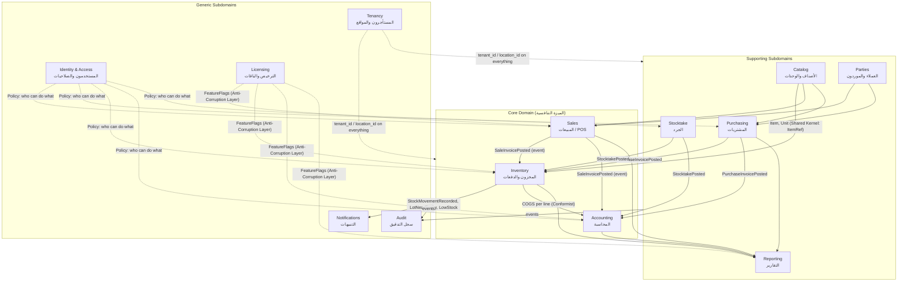

# نموذج المجال (Domain Model) — DDD

> **المنهجية:** Domain-Driven Design (Evans/Vernon). هذه الوثيقة تحدد **Bounded Contexts**، **Aggregates**، **Entities/Value Objects**، **Invariants** (القواعد الثابتة)، و**Domain Events**. الكود في `packages/domain` يجب أن يعكسها حرفياً.
> **القاعدة الذهبية:** منطق الأعمال يعيش هنا فقط — لا في Controllers، لا في الواجهة، لا في SQL (إلا كقيود حماية إضافية).

---

## 1. خريطة السياقات (Context Map)



### أنواع العلاقات
| العلاقة | النوع | الشرح |
|---|---|---|
| Catalog → Inventory/Sales/Purchasing | **Shared Kernel** (`ItemRef`, `UnitRef`, `Money`, `Quantity`) | كائنات قيمة مشتركة صغيرة في `packages/domain/shared` |
| Sales → Inventory, Accounting | **Domain Events** (Publisher/Subscriber داخل نفس Transaction) | Sales لا يعرف جداول المخزون؛ يُصدر حدثاً |
| Inventory → Accounting | **Conformist** | Accounting يقبل تكلفة الدفعة كما يحددها Inventory |
| Licensing → الكل | **Anti-Corruption Layer** (`FeaturePolicy` port) | السياقات تسأل "هل الميزة مفعّلة؟" عبر واجهة، لا تعرف تفاصيل التوكن |
| Identity → الكل | **Policy port** (`AuthorizationPolicy`) | — |
| Reporting | **Read Model / CQRS-light** | يقرأ Projections مباشرة (SQL) ولا يمر عبر Aggregates |

---

## 2. اللغة الموحدة (Ubiquitous Language)
الكامل في `GLOSSARY.md`. أهم القواعد:
- نقول **Lot** (دفعة) لا Batch في الكود؛ **Item** لا Product/Medicine؛ **Location** لا Warehouse/Branch (الفرع كيان تنظيمي، الموقع كيان مخزني)؛ **Post** لا Confirm/Finalize؛ **Reverse/Return** لا Delete/Cancel للمرحّل.
- **Quantity** دائماً عدد صحيح بالـ SSU داخل الـ Domain. التحويل من/إلى وحدات العرض يحدث عند الحدود.
- **Money** دائماً `{ amountMinor: bigint, currency: 'YER' | 'SAR' | 'USD' }`.

---

## 3. الكائنات المشتركة (Shared Kernel — Value Objects)

```ts
// packages/domain/shared
Money        { amountMinor: bigint; currency: CurrencyCode }   // immutable; add/sub/mul(rate)/allocate(parts)
Quantity     { ssu: number }                                   // integer ≥ 0; add/sub/isZero
UnitFactor   { factorToSsu: number }                           // integer ≥ 1
ExchangeRate { from; to; rate: Decimal(18,8); asOf: Date }
TenantId, LocationId, ItemId, LotId, UserId, DocumentId  // branded UUIDv7 strings
DateOnly     // YYYY-MM-DD بدون وقت (لتواريخ الانتهاء)
Percentage   // 0..100 بدقة 2
```
**Invariants:** `Money` لا يُجمع بعملتين مختلفتين؛ `Quantity.ssu` غير سالب؛ `allocate()` يوزع بدون فقد سنت (Largest Remainder).

---

## 4. السياقات والـ Aggregates

### 4.1 Catalog (الأصناف)
| Aggregate Root | **Item** |
|---|---|
| Entities | `ItemUnit[]` (علبة/شريط/حبة)، `Barcode[]` |
| Value Objects | `ItemNames {tradeAr, tradeEn, generic}`, `Classification {category, dosageForm, strength}`, `StockPolicy {minLevel, reorderQty, alertDays?}` |
| Invariants | ① وحدة أساسية واحدة بالضبط `factor=1` ② `factor` أعداد صحيحة ≥1 وفريدة داخل الصنف ③ الباركود فريد على مستوى المستأجر ④ لا حذف إن وُجدت حركات (تعطيل فقط) ⑤ سعر البيع لكل وحدة ≥ 0 |
| Commands | `CreateItem`, `UpdateItem`, `AddUnit`, `SetUnitPrice`, `AddBarcode`, `Deactivate`, `BulkUpdatePrices` |
| Events | `ItemCreated`, `ItemPriceChanged`, `ItemDeactivated` |

### 4.2 Inventory (المخزون) — **Core**
| Aggregate Root | **Lot** (الدفعة) |
|---|---|
| Value Objects | `LotIdentity {itemId, lotNumber?, expiryDate, unitCost: Money, supplierId?, sourceType}`، `AlertDate` (مشتق) |
| Invariants | ① `expiryDate` > تاريخ الاستلام ② `unitCost ≥ 0` ③ الدفعة لا تُعدَّل بعد أول حركة (ما عدا `lotNumber` و`expiryDate` بصلاحية مع تدقيق) |

| Aggregate Root | **StockLedger** (per `itemId + locationId`) — مفهومي |
|---|---|
| Entities | `StockMovement` (append-only): `{id, lotId, qtyDelta: int, unitCost: Money, type, referenceType, referenceId, postedAt, postedBy, reason?}` |
| Invariants | ① **Append-only** — لا تعديل/حذف ② `qtyDelta ≠ 0` ③ الرصيد الناتج لكل دفعة ≥ 0 إلا بسياسة `allowNegativeStock` (يُعلَّم) ④ كل حركة لها مرجع (مستند) أو سبب (تسوية) ⑤ لا حركة سالبة من دفعة منتهية إلا من نوع `expiry_writeoff` أو `transfer_out` |
| Domain Services | **`FefoAllocator.allocate(itemId, locationId, qty, {excludeExpired=true, preferLotId?})`** → `Allocation[] {lotId, qty, unitCost}` · **`StockBalanceProjector`** (يبني `stock_balances`) |
| Commands | `ReceiveStock(lines)`, `IssueStock(allocations, ref)`, `AdjustStock(lotId, delta, reason)`, `WriteOffLot`, `TransferOut/In`, `RecordOpeningBalance` |
| Events | `StockReceived`, `StockIssued`, `StockAdjusted`, `LotWrittenOff`, `StockTransferred`, `LotReachedAlertDate` (مجدول), `ItemBelowMinLevel` |
| Policies | **Removal strategy** = FEFO افتراضياً (قابلة للتهيئة لاحقاً per category/location مثل Odoo) |

### 4.3 Sales (المبيعات) — **Core**
| Aggregate Root | **SalesInvoice** |
|---|---|
| Entities | `SalesLine {itemId, unitId, qtyInUnit, qtySsu, unitPrice: Money, discount, lotAllocations[]: {lotId, qty, unitCost}}`، `Payment[] {method, amount: Money, currency, fxRate?}` |
| Value Objects | `InvoiceNumber {prefix, seq}`, `DocumentStatus: Draft | Posted | Reversed`, `Discount {type: amount|percent, value, approvedBy?}` |
| Invariants | ① Draft قابل للتعديل؛ **Posted غير قابل للتعديل نهائياً** ② `Σ payments = total` عند الترحيل (نقدي) أو `credit = total − Σ payments` (آجل) ③ الخصم ≤ حد الدور أو موافقة مسجّلة ④ البيع الآجل ≤ حد ائتمان العميل أو تجاوز بصلاحية ⑤ لكل سطر `Σ lotAllocations.qty = qtySsu` عند الترحيل ⑥ لا سطر من دفعة منتهية ⑦ الترقيم تسلسلي بلا فجوات للمرحّل (يُحجز عند الترحيل) ⑧ الترحيل يتطلب وردية مفتوحة للكاشير |
| Commands | `StartInvoice`, `AddLine`, `ChangeLineUnit/Qty`, `ApplyDiscount`, `HoldInvoice`, `ResumeInvoice`, **`PostInvoice(payments)`**, `CreateReturn(originalId, lines)` |
| Events | **`SalesInvoicePosted {lines[{itemId, lotId, qty, unitCost, unitPrice}], payments, customerId?, locationId, shiftId}`**, `SalesReturnPosted`, `DiscountOverridden` |
| Aggregate | **Shift**: `{cashierId, openedAt, openingCash, closedAt?, countedCash?, expectedCash (projection)}` · Invariants: وردية مفتوحة واحدة لكل كاشير؛ الإقفال يسجل الفرق |
| Aggregate | **Customer** (في Parties) مع `creditLimit`, `balance (projection)` |

### 4.4 Purchasing (المشتريات)
| Aggregate Root | **PurchaseInvoice** |
|---|---|
| Entities | `PurchaseLine {itemId, unitId, qtyInUnit, qtySsu, unitCost: Money, expiryDate, lotNumber?, bonusQtySsu, discount}` |
| Invariants | ① Posted غير قابل للتعديل ② `expiryDate` > اليوم (تحذير إن < 6 أشهر) ③ كل سطر ينتج **Lot جديداً** عند الترحيل (البونص يُنشئ حركة بتكلفة 0 أو يُوزَّع على التكلفة — سياسة) ④ المورد نشط |
| Commands | `CreatePurchase`, `AddLine`, `PostPurchase(paymentTerms)`, `CreatePurchaseReturn(lotIds)`, `RecordSupplierPayment` |
| Events | **`PurchaseInvoicePosted {lines[{itemId, lotData, qty, unitCost}], supplierId, total, paid}`**, `PurchaseReturnPosted`, `SupplierPaid` |

### 4.5 Accounting (المحاسبة) — **Core**
| Aggregate Root | **JournalEntry** |
|---|---|
| Entities | `JournalLine {accountId, debit: Money, credit: Money, currency, fxRate?, baseAmount: Money}` |
| Invariants | ① **`Σ debit = Σ credit`** (بالعملة الأساسية) ② سطر واحد إما مدين أو دائن (لا كلاهما، لا صفر) ③ **Append-only**؛ العكس بقيد جديد `reversalOf` ④ لا ترحيل قبل `lockDate` إلا للمالك ⑤ كل قيد له مصدر (`referenceType/id`) أو `manual` بصلاحية |
| Aggregate | **Account** (دليل الحسابات): `{code, nameAr, type, parentId, isSystem}` · Invariants: الحسابات النظامية (Cash, Sales, COGS, Inventory, AR, AP) لا تُحذف |
| Domain Services | **`PostingRules`**: يحوّل أحداث الأعمال إلى قيود (جدول القيود في R6 §5) · **`FxService`**: تحويل بسعر اليوم + فرق العملة عند التسوية · **`AccountBalanceProjector`** |
| Commands | `PostJournalEntry`, `ReverseEntry`, `CreateManualEntry`, `RecordExpense`, `RecordCustomerReceipt`, `SetLockDate` |
| Events | `JournalEntryPosted`, `EntryReversed`, `PeriodLocked` |
| Read Models | TrialBalance, P&L, BalanceSheet, AccountLedger, Aging — SQL مباشر على Projections |

### 4.6 Stocktake (الجرد)
| Aggregate Root | **StocktakeSession** |
|---|---|
| Entities | `CountLine {itemId, lotId, systemQty (snapshot), countedQty?, countedBy, countedAt}` |
| Value Objects | `Scope: Full | Category[] | Items[] | Spot`, `Status: Open | Counting | Review | Posted` |
| Invariants | ① Snapshot للكميات عند الفتح ② لا ترحيل مع أسطر غير معدودة (أو تُعتبر = النظام بقرار صريح) ③ بعد الترحيل مقفلة ④ **خيار تجميد الحركة** للنطاق أثناء الجرد (سياسة) |
| Commands | `OpenSession(scope)`, `RecordCount`, `ReviewVariances`, **`PostSession`** |
| Events | **`StocktakePosted {variances[{lotId, delta, unitCost}]}`** |

### 4.7 Parties (العملاء والموردون)
- `Customer {name, phone, creditLimit, isActive}` · `Supplier {name, phone, paymentTermsDays, isActive}` · الأرصدة Projections من Accounting.

### 4.8 Identity & Access
- `User {username, passwordHash, pin?, roles[], isActive, failedAttempts}` · `Role {name, permissions[]}` · `Permission` = سلسلة `context.action[.constraint]` مثل `sales.discount.max:10`.
- **`AuthorizationPolicy.can(user, action, context)`** — port تستخدمه كل السياقات.

### 4.9 Licensing
- `LicenseState {token, plan, features[], seats, exp, graceDays, lastVerifiedAt (ratchet), machineId}`.
- **`FeaturePolicy.isEnabled(feature)`** — port.
- Invariants: التوقيع صالح؛ `machineId` يطابق؛ `now ≥ lastVerifiedAt`.

### 4.10 Tenancy
- `Tenant {name, baseCurrency, settings}` · `Location {tenantId, name, type: store|warehouse, invoicePrefix}`.

### 4.11 Audit
- `AuditEntry {actor, action, entityType, entityId, before?, after?, at, deviceId}` — append-only، يستمع لكل الأحداث.

### 4.12 Notifications
- يستمع لـ `LotReachedAlertDate`, `ItemBelowMinLevel`, `ShiftClosedWithVariance`, `BackupFailed` → يعرض في Dashboard / يرسل لاحقاً.

---

## 5. سيناريو الترحيل الكامل (Saga داخل Transaction واحدة)

```mermaid
sequenceDiagram
  participant UI as POS UI
  participant APP as Sales App Service
  participant SAL as SalesInvoice (Aggregate)
  participant FEFO as FefoAllocator (Inventory)
  participant INV as StockLedger
  participant ACC as PostingRules (Accounting)
  participant AUD as Audit
  participant DB as Unit of Work (Tx)

  UI->>APP: PostInvoice(cmd)
  APP->>DB: begin
  APP->>FEFO: allocate(line.item, location, qty)
  FEFO-->>APP: allocations[{lot, qty, unitCost}]
  APP->>SAL: post(allocations, payments)  [checks invariants]
  SAL-->>APP: SalesInvoicePosted event
  APP->>INV: append movements (−qty per lot)   [checks ≥0, not expired]
  APP->>ACC: post entry (Cash/AR ↔ Sales; COGS ↔ Inventory)  [checks Σd=Σc]
  APP->>AUD: record
  APP->>DB: insert outbox(event)
  APP->>DB: commit
  DB-->>UI: InvoiceNumber + receipt payload
  Note over DB: أي فشل → rollback كامل؛ لا حالة وسيطة
```

**ملاحظة معمارية:** في Modular Monolith نستخدم **In-process event dispatch داخل نفس Transaction** (Unit of Work) لضمان الاتساق القوي (CH-N01)، مع كتابة الحدث في `outbox` للمزامنة/التكاملات الخارجية لاحقاً (R8).

---

## 6. سياسات الأعمال القابلة للتهيئة (Tenant Policies)
| السياسة | الافتراضي | يؤثر على |
|---|---|---|
| `removalStrategy` | FEFO | FefoAllocator |
| `allowNegativeStock` | false | StockLedger |
| `blockExpiredSales` | true | StockLedger/Sales |
| `alertDaysDefault` | 90 | Lot.alertDate |
| `discountLimitByRole` | Cashier 5%, Manager 20%, Owner ∞ | Sales |
| `requireShiftForSales` | true | Sales |
| `bonusCostPolicy` | `zero_cost` أو `spread` | Purchasing |
| `roundingMode` | HALF_UP إلى أصغر وحدة نقدية | Money |
| `lockDate` | null | Accounting |
| `invoicePrefixPerLocation` | `A-` | Sales |

---

## 7. قواعد الاتساق بين السياقات (Consistency Boundaries)
- **قوي (نفس Transaction):** Sales/Purchasing/Stocktake ↔ Inventory ↔ Accounting ↔ Audit. (مبرر: صيدلية صغيرة؛ خطأ في المخزون أو الحساب غير مقبول؛ CH-N01).
- **نهائي (Eventual):** Notifications، Reporting projections الثقيلة (يمكن تأخيرها ثوانٍ)، المزامنة السحابية.

---

## 8. ما يترتب في الكود (`packages/domain`)
```
packages/domain/src/
  shared/           Money, Quantity, ids, DateOnly, Result<T,E>, DomainEvent, AggregateRoot
  catalog/          Item, ItemUnit, Barcode, errors, events
  inventory/        Lot, StockMovement, FefoAllocator, StockPolicy, events
  sales/            SalesInvoice, SalesLine, Shift, PostingRules(sales), events
  purchasing/       PurchaseInvoice, events
  accounting/       JournalEntry, Account, PostingRules, FxService
  stocktake/        StocktakeSession
  parties/          Customer, Supplier
  identity/         AuthorizationPolicy (port), Permission
  licensing/        FeaturePolicy (port)
  ports/            repositories (interfaces only), Clock, IdGenerator, UnitOfWork
```
- **صفر تبعيات خارجية** في `packages/domain` (لا Prisma، لا Nest، لا React). اختبار Unit بـ Vitest فقط.
- كل Aggregate يُرجع `Result<Event[], DomainError>` بدلاً من رمي استثناءات (قابلية اختبار + رسائل واضحة للمستخدم).
