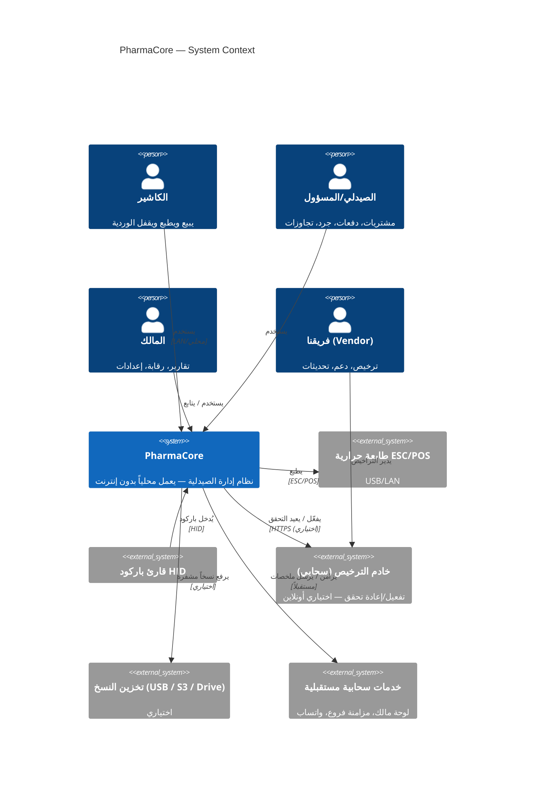
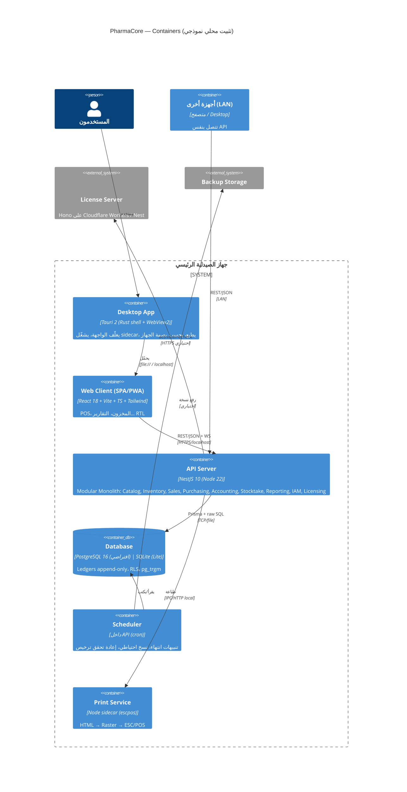

# المعمارية (Architecture) — C4 Model

> **النمط:** Modular Monolith + Hexagonal (Ports & Adapters) + DDD + CQRS-light، Offline-first، Multi-tenant-ready.
> **المبدأ:** تطبيق واحد سهل النشر على جهاز الصيدلية، بحدود داخلية صارمة تسمح بالتفكيك إلى خدمات عند الحاجة بدون إعادة كتابة.
> القرارات التفصيلية في `adr/`. القواعد الملزمة في `ENGINEERING-RULES.md`.

---

## 1. C4 — Level 1: System Context



## 2. C4 — Level 2: Containers



**وضع النشر:**
| الوضع | المكونات | الاستخدام |
|---|---|---|
| **Lite** (العميل الأول — افتراضي) | Tauri + sidecar (API + SQLite) في جهاز واحد | صيدلية بجهاز واحد؛ صفر تثبيت خدمات |
| **Local Server** | خدمة Windows (API + PostgreSQL) + أجهزة LAN بالمتصفح/Desktop | 2–5 أجهزة |
| **Cloud / SaaS** (مرحلة 7) | API في Docker + PostgreSQL مُدار + PowerSync + CDN للـ SPA | فروع متعددة، مئات المستأجرين |

نفس الكود في الأوضاع الثلاثة؛ الفرق في التهيئة والـ Adapters.

## 3. C4 — Level 3: Components (داخل API)

```mermaid
flowchart TB
  subgraph API["apps/api (NestJS)"]
    direction TB
    GW[HTTP Layer<br/>Controllers · DTO(Zod) · OpenAPI · Guards(Auth, Tenant, License, RBAC)]
    subgraph MOD["Modules (Bounded Contexts) — حدود صارمة"]
      direction LR
      M1[Catalog]
      M2[Inventory]
      M3[Sales]
      M4[Purchasing]
      M5[Accounting]
      M6[Stocktake]
      M7[Parties]
      M8[Reporting<br/>(Read Models)]
      M9[IAM]
      M10[Licensing]
      M11[Tenancy]
      M12[Audit]
      M13[Notifications]
      M14[Backup/Updates]
    end
    EB[In-process Event Bus<br/>+ Transactional Outbox]
    UOW[Unit of Work<br/>(Prisma Tx)]
    INFRA[Infrastructure Adapters<br/>Prisma Repos · Clock · IdGen(UUIDv7) · Printer · FS · HTTP(License)]
  end
  DOM[(packages/domain<br/>Pure TS — Aggregates, VOs, Domain Services, Ports)]
  SH[(packages/shared<br/>Zod schemas · types · i18n · constants)]

  GW --> MOD
  MOD --> DOM
  MOD --> EB
  MOD --> UOW
  UOW --> INFRA
  MOD --> SH
  GW --> SH
```

### بنية كل Module (Hexagonal داخل الوحدة)
```
apps/api/src/modules/sales/
  presentation/      controllers, dtos (zod → class), mappers        ← Adapter (inbound)
  application/       use-cases (commands/queries), app services, event handlers
  infrastructure/    prisma repositories (implement domain ports), external adapters ← Adapter (outbound)
  sales.module.ts    wiring (DI) + public API (exports) فقط
```
- **القاعدة:** Module لا يستورد من `infrastructure/` أو `application/` لوحدة أخرى — فقط من `@pharmacore/domain` (الأنواع المشتركة) أو عبر **الأحداث** أو عبر **Public Facade** معلن صراحة (مثل `InventoryFacade.allocateFefo()` لاستدعاء متزامن داخل نفس Transaction).
- تُفرض بـ `eslint-plugin-boundaries`.

## 4. تدفق الطلب (Request Flow) — مثال: ترحيل فاتورة
```
POST /api/v1/sales/invoices/{id}/post
 → AuthGuard (JWT) → TenantGuard (tenant_id من التوكن) → LicenseGuard (feature: pos) → RbacGuard (sales.post)
 → Controller → Zod validate → PostInvoiceCommand
 → PostInvoiceHandler (application):
      uow.run(async tx => {
        invoice   = salesRepo.load(id)                       // Aggregate
        allocs    = inventoryFacade.allocateFefo(lines, loc) // Domain Service (Inventory)
        events    = invoice.post(allocs, payments, policy)   // Invariants
        salesRepo.save(invoice)
        inventoryFacade.issue(allocs, ref)                   // append movements
        accountingFacade.post(PostingRules.forSale(events))  // journal
        auditFacade.record(...)
        outbox.append(events)
      })
 → 200 { invoiceNumber, receipt }
```

## 5. الواجهة (apps/web) — بنية الميزات
```
apps/web/src/
  app/            router, providers, layouts (RTL), shell (status bar)
  features/       pos/, inventory/, purchasing/, accounting/, stocktake/, reports/, settings/, auth/
  entities/       item, lot, invoice… (api hooks via TanStack Query, generated from OpenAPI)
  shared/         ui (from packages/ui), lib (money fmt, dates, hotkeys), i18n
```
- **Offline resilience:** TanStack Query persist (IndexedDB) للقراءات؛ مسودات POS في IndexedDB؛ Service Worker (PWA) للـ assets.
- **Hotkeys** مركزية (خريطة R9).
- **لا منطق أعمال في الواجهة** — فقط تحقق شكلي (Zod المشترك) وتجربة مستخدم.

## 6. الديسكتوب (apps/desktop — Tauri 2)
- Rust core: بصمة الجهاز، تشغيل/إيقاف sidecar (API)، تحديث تلقائي (Tauri Updater موقّع)، طباعة (أو عبر sidecar Node)، فتح ملفات النسخ.
- يحمّل `apps/web` المبني محلياً.
- Installer: NSIS/MSI يضم Node runtime (مضغوط) + SQLite أو PostgreSQL portable حسب الوضع.

## 7. البيانات (ملخص — التفاصيل في docs/05-data)
- PostgreSQL 16 افتراضي؛ SQLite للـ Lite بنفس Prisma schema (فروق موثقة).
- Ledgers append-only بـ Triggers؛ Projections (`stock_balances`, `account_balances`) قابلة لإعادة البناء.
- UUID v7، `tenant_id` + RLS، `version`، soft delete للمرجعي فقط.
- الأموال `BIGINT minor` + `currency`.

## 8. الأمن (ملخص — docs/06-security)
- JWT access 15m + refresh (httpOnly)، Argon2id، RBAC Guards، RLS، Rate limiting، Helmet، CSP للـ SPA، تشفير النسخ، سجل تدقيق، ترخيص Ed25519.

## 9. قابلية الملاحظة (Observability)
- Logs منظمة (pino) → ملف دوّار محلي؛ مستوى قابل للتهيئة.
- Health endpoint `/health` (DB، طابعة، ترخيص، آخر نسخة).
- Diagnostic bundle (logs + config بلا أسرار) للدعم.
- لاحقاً: OpenTelemetry عند SaaS.

## 10. مسار التطور (Evolution Path)
| اليوم | غداً | بدون إعادة كتابة لأن… |
|---|---|---|
| Monolith محلي | SaaS متعدد المستأجرين | `tenant_id` + RLS موجودان؛ نفس API في Docker |
| In-process events | Message broker (NATS/Redis) | Outbox موجود؛ نغيّر الـ dispatcher adapter |
| SQLite/Postgres محلي | Postgres مركزي + PowerSync | Ledgers append-only + UUIDv7 + version |
| Module داخل Monolith | Microservice | حدود صارمة + Facade/Events فقط |
| Web/Desktop | Mobile | نفس SPA عبر Tauri Mobile/Capacitor؛ Domain مشترك |
| ترخيص بسيط | باقات SaaS + فوترة | `features[]` + FeaturePolicy port |

## 11. الـ ADRs المرتبطة
| ADR | العنوان |
|---|---|
| ADR-001 | Modular Monolith + Hexagonal + DDD |
| ADR-002 | Stack: TypeScript E2E — NestJS/Prisma/PostgreSQL|SQLite — React/Vite/Tailwind — Tauri 2 |
| ADR-003 | Multi-tenancy من اليوم الأول (tenant_id + RLS) |
| ADR-004 | Offline-first + Sync-ready data design |
| ADR-005 | المخزون: Lots + Immutable Ledger + FEFO + SSU integer |
| ADR-006 | المستندات: Draft → Posted غير قابل للتعديل؛ تصحيح بالعكس/المرتجع |
| ADR-007 | المحاسبة: قيد مزدوج Immutable + Specific Identification |
| ADR-008 | الأموال: BIGINT minor units + currency؛ لا Float |
| ADR-009 | الترخيص: Ed25519 + بصمة الجهاز + Offline grace + Feature flags |
| ADR-010 | المعرّفات: UUID v7 |
| ADR-011 | الأحداث: In-process داخل Transaction + Transactional Outbox |
| ADR-012 | الواجهة: React SPA واحدة لكل المنصات (Web/PWA/Tauri) |
