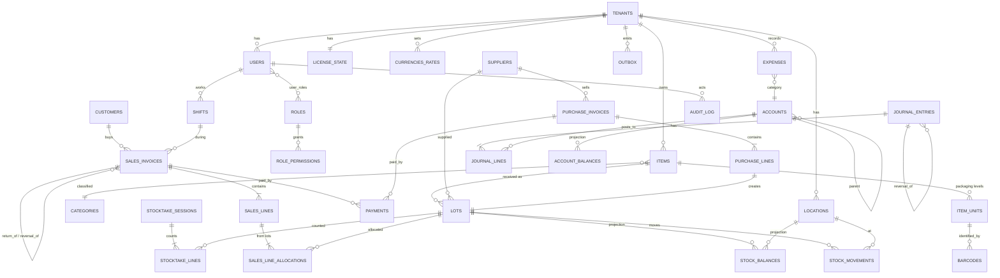

# نموذج البيانات (Data Model / ERD)

> **المصدر:** DOMAIN-MODEL.md + ADR-003/005/006/007/008/010. يُترجم إلى `prisma/schema.prisma` حرفياً.
> **اصطلاحات:** snake_case · كل جدول أعمال: `id UUIDv7 PK`, `tenant_id`, `created_at`, `updated_at` · المرجعي: `+ version, deleted_at` · الأموال: `*_minor BIGINT + currency` · الكميات: `INTEGER` بالـ SSU.
> **Ledgers (append-only):** `stock_movements`, `journal_entries`, `journal_lines`, `audit_log`, `outbox` — بلا `updated_at/deleted_at`.

---

## 1. ERD الشامل



## 2. الجداول بالتفصيل

### 2.1 Tenancy & Identity
| جدول | أعمدة رئيسية | ملاحظات |
|---|---|---|
| `tenants` | id, name, base_currency CHAR(3), settings JSONB (policies), created_at | — |
| `locations` | id, tenant_id, name, type ENUM(store,warehouse), invoice_prefix VARCHAR(8), next_invoice_seq INT, is_default | ترقيم لكل موقع |
| `users` | id, tenant_id, username UNIQUE(tenant), password_hash, pin_hash?, full_name, is_active, failed_attempts, locked_until, last_login_at | Argon2id |
| `roles` | id, tenant_id, name, is_system | Owner/Manager/Cashier/Accountant |
| `role_permissions` | role_id, permission VARCHAR(100), constraint_value? | `sales.discount.max` = `10` |
| `user_roles` | user_id, role_id | — |
| `license_state` | tenant_id PK, token TEXT, plan, features TEXT[], seats, exp, last_verified_at, machine_id | ratchet |
| `currencies` | code PK, name_ar, minor_units SMALLINT, symbol | ISO 4217 seed |
| `currency_rates` | id, tenant_id, from_code, to_code, rate NUMERIC(18,8), as_of DATE, set_by | يدوي |

### 2.2 Catalog
| جدول | أعمدة | قيود |
|---|---|---|
| `categories` | id, tenant_id, name_ar, name_en?, parent_id?, alert_days_override? | — |
| `items` | id, tenant_id, code VARCHAR(32), trade_name_ar, trade_name_en?, generic_name?, manufacturer?, category_id?, dosage_form?, strength?, min_level_ssu INT, reorder_qty_ssu INT, alert_days_override?, is_active, notes, search_vector tsvector (PG) , version, deleted_at | `UNIQUE(tenant_id, code)`؛ GIN على `search_vector` + `pg_trgm` على الأسماء |
| `item_units` | id, item_id, name_ar, factor_to_ssu INT ≥1, is_base BOOL, sell_price_minor BIGINT, currency, is_default_sale, sort_order | `UNIQUE(item_id, factor_to_ssu)`؛ **واحد فقط `is_base=true`** (partial unique index) |
| `barcodes` | id, tenant_id, item_unit_id, code VARCHAR(64), symbology ENUM(ean13,code128,gs1_datamatrix,custom) | `UNIQUE(tenant_id, code)` |

### 2.3 Parties
| جدول | أعمدة |
|---|---|
| `customers` | id, tenant_id, name, phone?, credit_limit_minor BIGINT, currency, is_active, notes, version |
| `suppliers` | id, tenant_id, name, phone?, address?, payment_terms_days INT, is_active, notes, version |

### 2.4 Inventory (Core)
| جدول | أعمدة | قيود |
|---|---|---|
| `lots` | id, tenant_id, item_id, lot_number VARCHAR(64)?, expiry_date DATE, alert_date DATE, unit_cost_minor BIGINT, currency, supplier_id?, source_type ENUM(official,parallel), received_at, purchase_line_id? | `CHECK(expiry_date > received_at::date)`؛ index `(tenant_id,item_id,expiry_date)` |
| **`stock_movements`** (append-only) | id, tenant_id, location_id, item_id, lot_id, qty_delta INT ≠0, unit_cost_minor BIGINT, currency, movement_type ENUM(opening, purchase_receipt, purchase_return, sale, sale_return, transfer_out, transfer_in, adjustment_gain, adjustment_loss, expiry_writeoff, damage_writeoff), reference_type VARCHAR(32)?, reference_id UUID?, reason TEXT?, posted_at, posted_by, device_id? | **Trigger: deny UPDATE/DELETE**؛ `CHECK(reference_id IS NOT NULL OR reason IS NOT NULL)`؛ index `(tenant_id,item_id,location_id,posted_at)`, `(lot_id)` |
| `stock_balances` (projection) | tenant_id, location_id, item_id, lot_id, on_hand_ssu INT ≥0*, last_movement_at | PK `(lot_id, location_id)`؛ يُحدَّث في نفس Tx بـ `INSERT…ON CONFLICT DO UPDATE`؛ `CHECK(on_hand_ssu >= 0)` إلا إن `allow_negative` |
| `item_location_balances` (projection) | tenant_id, location_id, item_id, on_hand_ssu, nearest_expiry DATE | للبحث السريع في POS |

### 2.5 Sales (Core)
| جدول | أعمدة | قيود |
|---|---|---|
| `shifts` | id, tenant_id, location_id, cashier_id, opened_at, opening_cash_minor, closed_at?, counted_cash_minor?, expected_cash_minor? (snapshot), variance_minor?, status ENUM(open,closed), notes | partial unique: وردية `open` واحدة لكل cashier |
| **`sales_invoices`** | id, tenant_id, location_id, shift_id, invoice_no VARCHAR(16)? (NULL في draft), status ENUM(draft,posted,reversed), kind ENUM(sale,return), return_of_id?, reversal_of_id?, customer_id?, subtotal_minor, discount_minor, total_minor, paid_minor, credit_minor, currency, fx_rate?, secondary_currency?, secondary_total_minor?, notes, idempotency_key UUID UNIQUE, posted_at?, posted_by?, created_by, version, device_id | `UNIQUE(location_id, invoice_no) WHERE invoice_no IS NOT NULL`؛ **Trigger: deny UPDATE/DELETE WHERE status='posted'** (ما عدا `status→reversed`) |
| `sales_lines` | id, invoice_id, item_id, item_unit_id, qty_in_unit INT, qty_ssu INT, unit_price_minor, discount_minor, line_total_minor, cogs_minor (sum of allocations), sort_order | — |
| `sales_line_allocations` | id, sales_line_id, lot_id, qty_ssu INT, unit_cost_minor | ربح السطر = line_total − Σ(qty×unit_cost) |
| `payments` | id, tenant_id, document_type ENUM(sales,purchase,customer_receipt,supplier_payment), document_id, method ENUM(cash,wallet,transfer,card,account), amount_minor, currency, fx_rate?, base_amount_minor, reference?, received_at, received_by | — |

### 2.6 Purchasing
| جدول | أعمدة |
|---|---|
| `purchase_invoices` | id, tenant_id, location_id, supplier_id, supplier_ref?, status ENUM(draft,posted,reversed), kind ENUM(purchase,return), return_of_id?, invoice_date, due_date?, subtotal_minor, discount_minor, total_minor, paid_minor, currency, fx_rate?, idempotency_key UNIQUE, posted_at?, posted_by?, created_by, version |
| `purchase_lines` | id, invoice_id, item_id, item_unit_id, qty_in_unit INT, qty_ssu INT, bonus_qty_ssu INT, unit_cost_minor, discount_minor, line_total_minor, expiry_date DATE, lot_number?, lot_id? (بعد الترحيل), new_sell_price_minor? |

### 2.7 Stocktake
| جدول | أعمدة |
|---|---|
| `stocktake_sessions` | id, tenant_id, location_id, scope ENUM(full,category,items,spot), scope_ref JSONB, status ENUM(open,counting,review,posted), freeze_movements BOOL, opened_at, opened_by, posted_at?, posted_by?, notes |
| `stocktake_lines` | id, session_id, item_id, lot_id, system_qty_ssu INT (snapshot), counted_qty_ssu INT?, variance_ssu INT (generated), unit_cost_minor, counted_by?, counted_at? |

### 2.8 Accounting (Core)
| جدول | أعمدة | قيود |
|---|---|---|
| `accounts` | id, tenant_id, code VARCHAR(16), name_ar, name_en?, type ENUM(asset,liability,equity,revenue,expense), parent_id?, is_system BOOL, system_key? (cash, bank, ar, ap, inventory, sales, sales_returns, cogs, inventory_loss, inventory_gain, expiry_loss, fx_gain, fx_loss, discount_given, opening_equity), is_active | `UNIQUE(tenant_id, code)`؛ `is_system` لا يُحذف |
| **`journal_entries`** (append-only) | id, tenant_id, entry_no BIGINT (seq per tenant), entry_date DATE, description, reference_type?, reference_id?, reversal_of_id?, is_manual BOOL, posted_at, posted_by | Trigger deny UPDATE/DELETE |
| **`journal_lines`** (append-only) | id, entry_id, account_id, debit_minor BIGINT ≥0, credit_minor BIGINT ≥0, currency, fx_rate NUMERIC(18,8), base_debit_minor, base_credit_minor, memo? | `CHECK((debit>0 AND credit=0) OR (credit>0 AND debit=0))`؛ **Deferred constraint trigger: Σbase_debit = Σbase_credit per entry** |
| `account_balances` (projection) | tenant_id, account_id, period (YYYY-MM), debit_minor, credit_minor | لتقارير سريعة؛ قابل لإعادة البناء |
| `expenses` | id, tenant_id, location_id?, account_id (expense), amount_minor, currency, paid_from_account_id, expense_date, description, attachment_path?, journal_entry_id, created_by | واجهة مبسطة تولّد قيداً |
| `period_locks` | tenant_id, lock_date DATE, set_by, set_at | — |

### 2.9 Cross-cutting
| جدول | أعمدة |
|---|---|
| **`audit_log`** (append-only) | id, tenant_id, actor_id, action VARCHAR(64), entity_type, entity_id, before JSONB?, after JSONB?, reason?, at, device_id?, ip? |
| **`outbox`** (append-only + processed_at) | id, tenant_id, event_type, event_version SMALLINT, payload JSONB, occurred_at, processed_at?, attempts SMALLINT, last_error? |
| `settings` | tenant_id, key, value JSONB, updated_at, updated_by |
| `backups` | id, tenant_id, path, size_bytes, sha256, kind ENUM(scheduled,manual,pre_update), created_at, status, destination |
| `numbering_sequences` | tenant_id, scope (location_id/entity), next_value BIGINT | قفل صف عند الترحيل |
| `devices` | id, tenant_id, machine_id, name, last_seen_at, app_version | للترخيص والتدقيق |

## 3. القيود على مستوى قاعدة البيانات (PostgreSQL)

```sql
-- 3.1 منع التعديل على الـ Ledgers
CREATE OR REPLACE FUNCTION deny_mutation() RETURNS trigger AS $$
BEGIN RAISE EXCEPTION 'Table % is append-only', TG_TABLE_NAME; END; $$ LANGUAGE plpgsql;

CREATE TRIGGER stock_movements_immutable BEFORE UPDATE OR DELETE ON stock_movements
  FOR EACH ROW EXECUTE FUNCTION deny_mutation();
-- نفس الشيء: journal_entries, journal_lines, audit_log

-- 3.2 منع تعديل المستندات المرحّلة (يسمح فقط بـ status → reversed)
CREATE OR REPLACE FUNCTION protect_posted_document() RETURNS trigger AS $$
BEGIN
  IF TG_OP = 'DELETE' AND OLD.status = 'posted' THEN RAISE EXCEPTION 'Posted document cannot be deleted'; END IF;
  IF TG_OP = 'UPDATE' AND OLD.status = 'posted' THEN
    IF NOT (NEW.status = 'reversed' AND NEW.reversal_of_id IS NOT NULL
            AND to_jsonb(NEW) - 'status' - 'reversal_of_id' - 'updated_at' - 'version'
              = to_jsonb(OLD) - 'status' - 'reversal_of_id' - 'updated_at' - 'version') THEN
      RAISE EXCEPTION 'Posted document is immutable';
    END IF;
  END IF;
  RETURN NEW;
END; $$ LANGUAGE plpgsql;
CREATE TRIGGER sales_invoices_protect BEFORE UPDATE OR DELETE ON sales_invoices
  FOR EACH ROW EXECUTE FUNCTION protect_posted_document();
-- نفس الشيء: purchase_invoices, stocktake_sessions

-- 3.3 توازن القيد (Deferred — يُفحص عند COMMIT)
CREATE OR REPLACE FUNCTION check_entry_balanced() RETURNS trigger AS $$
DECLARE d BIGINT; c BIGINT;
BEGIN
  SELECT COALESCE(SUM(base_debit_minor),0), COALESCE(SUM(base_credit_minor),0) INTO d, c
  FROM journal_lines WHERE entry_id = COALESCE(NEW.entry_id, OLD.entry_id);
  IF d <> c THEN RAISE EXCEPTION 'Journal entry % unbalanced: debit % credit %', NEW.entry_id, d, c; END IF;
  RETURN NULL;
END; $$ LANGUAGE plpgsql;
CREATE CONSTRAINT TRIGGER journal_balanced AFTER INSERT ON journal_lines
  DEFERRABLE INITIALLY DEFERRED FOR EACH ROW EXECUTE FUNCTION check_entry_balanced();

-- 3.4 لا بيع من دفعة منتهية
CREATE OR REPLACE FUNCTION check_not_expired_on_sale() RETURNS trigger AS $$
BEGIN
  IF NEW.movement_type = 'sale' AND NEW.qty_delta < 0 THEN
    PERFORM 1 FROM lots WHERE id = NEW.lot_id AND expiry_date > CURRENT_DATE;
    IF NOT FOUND THEN RAISE EXCEPTION 'Cannot sell from expired lot %', NEW.lot_id; END IF;
  END IF;
  RETURN NEW;
END; $$ LANGUAGE plpgsql;
CREATE TRIGGER sm_not_expired BEFORE INSERT ON stock_movements
  FOR EACH ROW EXECUTE FUNCTION check_not_expired_on_sale();

-- 3.5 RLS (كل جدول أعمال)
ALTER TABLE items ENABLE ROW LEVEL SECURITY;
CREATE POLICY tenant_isolation ON items
  USING (tenant_id = current_setting('app.tenant_id', true)::uuid);
-- … يُولَّد لكل جدول عبر migration template

-- 3.6 وحدة أساسية واحدة
CREATE UNIQUE INDEX item_units_one_base ON item_units(item_id) WHERE is_base;

-- 3.7 وردية مفتوحة واحدة
CREATE UNIQUE INDEX shifts_one_open ON shifts(cashier_id) WHERE status = 'open';
```

### فروق SQLite (وضع Lite)
| الميزة | PostgreSQL | SQLite | المعالجة |
|---|---|---|---|
| Triggers | ✅ | ✅ (بصيغة مختلفة، بلا deferred) | توازن القيد يُفحص في التطبيق + trigger AFTER INSERT على آخر سطر |
| RLS | ✅ | ❌ | Prisma middleware يحقن `tenant_id` (مستأجر واحد) |
| `pg_trgm`/tsvector | ✅ | FTS5 | Adapter بحث مختلف خلف نفس Port |
| `uuid` | native | TEXT | Prisma |
| BIGINT | ✅ | INTEGER 64-bit | ✅ |
| JSONB | ✅ | TEXT (JSON1) | Prisma `Json` |
| Partial unique index | ✅ | ✅ | ✅ |

## 4. دليل الحسابات الافتراضي (Seed)
| الكود | الاسم | النوع | system_key |
|---|---|---|---|
| 1000 | الأصول | asset | — |
| 1100 | الصندوق | asset | cash |
| 1200 | البنك / المحافظ | asset | bank |
| 1300 | ذمم العملاء | asset | ar |
| 1400 | المخزون | asset | inventory |
| 2000 | الالتزامات | liability | — |
| 2100 | ذمم الموردين | liability | ap |
| 3000 | حقوق الملكية | equity | — |
| 3100 | رأس المال / رصيد افتتاحي | equity | opening_equity |
| 3200 | الأرباح المحتجزة | equity | retained |
| 4000 | الإيرادات | revenue | — |
| 4100 | المبيعات | revenue | sales |
| 4110 | مرتجعات المبيعات (−) | revenue | sales_returns |
| 4120 | خصومات ممنوحة (−) | revenue | discount_given |
| 4200 | أرباح فروق عملة | revenue | fx_gain |
| 4300 | زيادة جرد | revenue | inventory_gain |
| 5000 | المصروفات | expense | — |
| 5100 | تكلفة البضاعة المباعة | expense | cogs |
| 5200 | خسائر انتهاء صلاحية/تلف | expense | expiry_loss |
| 5300 | عجز جرد | expense | inventory_loss |
| 5400 | خسائر فروق عملة | expense | fx_loss |
| 5500 | إيجار | expense | — |
| 5510 | كهرباء ومولد | expense | — |
| 5520 | رواتب | expense | — |
| 5530 | مصروفات أخرى | expense | — |

## 5. قواعد الترحيل المحاسبي (PostingRules) — مرجع سريع
انظر `ACCOUNTING-DESIGN.md` للتفصيل والأمثلة الرقمية.

## 6. الفهارس الحرجة
- `items`: GIN(search_vector), GIN(trade_name_ar gin_trgm_ops), (tenant_id, is_active)
- `barcodes`: UNIQUE(tenant_id, code)
- `stock_movements`: (tenant_id, item_id, location_id, posted_at DESC), (lot_id), (reference_type, reference_id)
- `stock_balances`: PK(lot_id, location_id), (tenant_id, item_id, location_id) WHERE on_hand_ssu>0
- `lots`: (tenant_id, expiry_date) WHERE … للتنبيهات
- `sales_invoices`: (tenant_id, location_id, posted_at DESC), (customer_id), UNIQUE(idempotency_key)
- `journal_lines`: (account_id, entry_id); `journal_entries`: (tenant_id, entry_date)
- `audit_log`: (tenant_id, at DESC), (entity_type, entity_id)
- `outbox`: (processed_at) WHERE processed_at IS NULL

## 7. الهجرات (Migrations)
- Prisma Migrate؛ كل migration باسم `YYYYMMDDHHMM_<slug>`.
- الـ Triggers/RLS/الفهارس الخاصة في ملفات SQL داخل migrations (Prisma `--create-only` ثم تعديل).
- Seed: currencies, default roles/permissions, chart of accounts, demo tenant (dev فقط).
- أمر `rebuild-projections` لإعادة بناء `stock_balances`, `item_location_balances`, `account_balances`.
