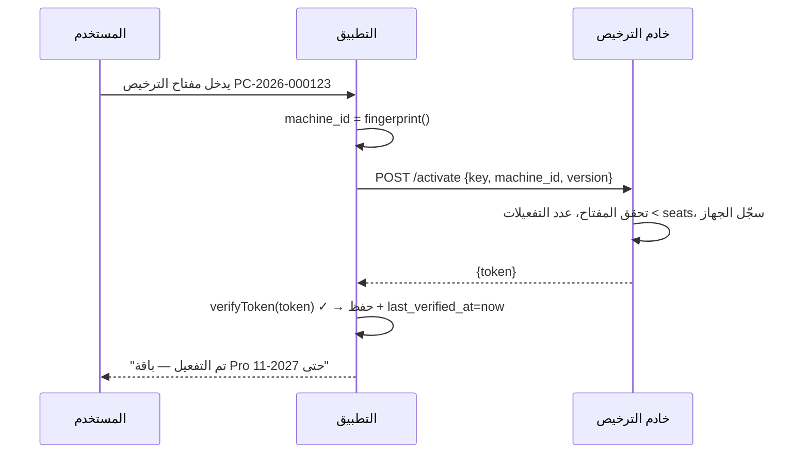

# تصميم الترخيص (Licensing Design)

> **المرجع:** ADR-009، R7. هذه الوثيقة تفصيلية للتنفيذ في `packages/license-sdk` و`apps/license-server`.

---

## 1. المكونات
```
apps/license-server (Hono على Cloudflare Workers + D1)  ← لنا فقط
  POST /v1/license/activate   { license_key, machine_id, app_version }  → { token }
  POST /v1/license/recheck    { token, machine_id }                      → { token } | 401/403
  POST /v1/license/deactivate { token, machine_id }                      → 200  (نقل جهاز)
  Admin UI: إنشاء ترخيص، تحديد plan/features/seats/exp، عرض التفعيلات، إلغاء، توليد توكن أوفلاين

packages/license-sdk (TS + Rust binding في Tauri)
  verifyToken(token, publicKey, machineId, now) → { ok, payload } | { ok:false, reason }
  getMachineId() → string (32 hex)
  LicenseStore (قراءة/كتابة token + last_verified_at)
  FeaturePolicy.isEnabled(feature)
```

## 2. صيغة التوكن
```
<base64url(JSON payload)>.<base64url(Ed25519 signature over payload bytes)>
```
```json
{
  "v": 1,
  "lic": "PC-2026-000123",
  "tenant": "018f3b2c-...-uuidv7",
  "mid": "a3f1b2c9d4e5f6a7b8c9d0e1f2a3b4c5",
  "plan": "pro",
  "features": ["pos","inventory","purchasing","accounting","stocktake","reports","multi_user","backup_cloud","multi_currency"],
  "seats": 2,
  "kind": "perpetual",          // perpetual | subscription
  "iat": 1762128000,
  "exp": 1793664000,            // perpetual: نهاية التحديثات؛ subscription: نهاية الخدمة
  "grace_days": 30,
  "recheck_days": 30,
  "min_app_version": "1.0.0"
}
```

## 3. الباقات (Plans) — مقترح أولي
| الميزة (feature key) | Starter | Pro | Enterprise |
|---|---|---|---|
| `pos`, `inventory`, `reports_basic`, `backup_local` | ✅ | ✅ | ✅ |
| `purchasing`, `stocktake`, `accounting`, `reports_financial` | ✅ | ✅ | ✅ |
| `multi_user` (seats) | 1 جهاز | 3 أجهزة | غير محدود |
| `multi_currency` | ❌ | ✅ | ✅ |
| `multi_location` | ❌ | ✅ | ✅ |
| `backup_cloud` | ❌ | ✅ | ✅ |
| `owner_mobile` (لوحة مالك) | ❌ | ✅ | ✅ |
| `branch_sync` | ❌ | ❌ | ✅ |
| `api_access` / تكاملات | ❌ | ❌ | ✅ |
> العميل الأول = **Pro** بسعر Starter كمرجع (Reference customer).

## 4. بصمة الجهاز (Machine ID)
```
factors (sorted by key):
  mid  = Windows MachineGuid | /etc/machine-id | IOPlatformUUID     (أساسي، وزن 3)
  vol  = Volume serial of system drive                                (ثانوي، وزن 1)
  cpu  = CPU brand + cores                                            (ثانوي، وزن 1)
  mac  = أول MAC غير عشوائي (bit 41 = 0)                              (ثانوي، وزن 1)
machine_id = sha256(join("|", "k:v"...))[0:32]
```
- **التسامح:** التوكن يحمل `mid` الكامل + `mid_factors_hash[]` لكل عامل؛ عند التحقق: الأساسي يطابق **و** ≥ 2 من 3 ثانويات تطابق → مقبول. (يمنع إزعاج تغيير كرت الشبكة.)
- يُنفَّذ في Rust (Tauri) للديسكتوب؛ Node (`systeminformation`) للخادم المحلي.

## 5. تدفقات

### 5.1 تفعيل أونلاين


### 5.2 تفعيل أوفلاين (الأهم لليمن)
1. التطبيق يعرض **Machine Code** (`mid` بصيغة مجموعات: `A3F1-B2C9-D4E5-...`) + زر نسخ/QR.
2. الفني يرسله لنا (واتساب) مع رقم الترخيص.
3. من لوحة الإدارة نولّد التوكن ونرسله نصاً/ملف `.pclic`.
4. المستخدم يلصق/يستورد → تحقق محلي → مفعّل. **صفر إنترنت على جهاز الصيدلية.**

### 5.3 تشغيل التطبيق
```
token ← store.read()
if !token → شاشة تفعيل
now ← clock.now()
if now < store.last_verified_at → FAIL(clock_rollback) → شاشة تفعيل + تنبيه
r ← verifyToken(token, PUBKEY, machine_id, now)
if !r.ok → FAIL(r.reason)
if now > exp:
   if kind=perpetual → OK (read features; updates disabled)
   if kind=subscription and now > exp+grace → READ_ONLY mode
store.last_verified_at ← now
schedule recheck if (now - last_recheck) > recheck_days and online
```

### 5.4 إعادة التحقق الصامتة
- نجاح → توكن جديد (قد يحمل ترقية/تمديد).
- 401/403/404 → إلغاء محلي + شاشة تفعيل.
- 5xx/timeout/offline → لا شيء (fail-open ضمن grace).

### 5.5 نقل الترخيص لجهاز جديد
- من التطبيق القديم: "إلغاء تفعيل هذا الجهاز" (أونلاين) أو يطلب الفني إلغاءه من لوحتنا.
- التفعيل على الجديد (أونلاين/أوفلاين).
- حد: نقلتان مجانيتان/سنة ثم مراجعة يدوية (ضد المشاركة).

## 6. أوضاع التشغيل عند مشاكل الترخيص
| الحالة | السلوك |
|---|---|
| لا ترخيص | شاشة تفعيل فقط |
| منتهي (perpetual) | كل شيء يعمل؛ شريط "التحديثات متوقفة — جدّد الدعم"؛ لا تحديثات |
| منتهي + سماح (subscription) | كل شيء يعمل + شريط تحذير يومي |
| منتهي بعد السماح (subscription) | **قراءة فقط**: عرض/طباعة/تصدير كل البيانات؛ لا بيع/شراء/تعديل |
| بصمة لا تطابق | شاشة تفعيل + "يبدو أن الجهاز تغيّر — تواصل مع الدعم" + Machine Code الجديد |
| إرجاع الساعة | كما أعلاه + تسجيل في التدقيق |

## 7. الدفاع في العمق
| الطبقة | الآلية |
|---|---|
| Tauri (Rust) | يتحقق قبل تشغيل sidecar؛ المفتاح العام مضمّن في binary |
| API Guard | `LicenseGuard` عالمي؛ `@RequireFeature()` |
| Prisma middleware | يرفض الكتابة في READ_ONLY |
| DB | `license_state.tenant_id` يجب أن يطابق `tenants.id` الوحيد في Lite؛ نسخ DB لجهاز آخر = tenant لا يطابق توكنه |
| Build | minify + source maps خارج التوزيع؛ Rust للمنطق الحساس |

## 8. خادم الترخيص — نموذج البيانات
```
licenses      id, key (hash), tenant_id, customer_name, plan, features[], seats, kind, exp, grace_days, recheck_days, status, notes, created_at
activations   id, license_id, machine_id, device_name, app_version, first_seen, last_seen, status(active|deactivated)
events        id, license_id, type(activate|recheck|deactivate|revoke|transfer), machine_id, at, ip
```
- المفتاح الخاص في Cloudflare Secret؛ تدوير سنوي مع دعم مفتاحين عامين في التطبيق (kid).

## 9. الإجراءات التشغيلية (Runbooks)
| الحالة | الخطوات |
|---|---|
| إصدار ترخيص جديد | Admin UI → New License → plan/seats/exp → نسخ المفتاح للعميل |
| عميل غيّر جهازه | تحقق من الهوية → Deactivate القديم → العميل يفعّل الجديد |
| عميل لم يجدد الدعم | لا شيء (perpetual)؛ عرض تجديد |
| اشتباه مشاركة | عرض `activations` و`events` → إلغاء الزائد → تواصل |
| تسريب المفتاح الخاص | تدوير المفتاح → إصدار تحديث بالمفتاح الجديد → إعادة إصدار التوكنات |

## 10. الأخلاقيات والعقد
- EULA عربي: عدد الأجهزة، مدة الدعم/التحديثات، **ملكية البيانات للعميل**، التصدير دائماً، لا جمع بيانات مبيعات بدون موافقة.
- لا "قنبلة موقوتة" تمحو بيانات. أقصى إجراء = قراءة فقط.
