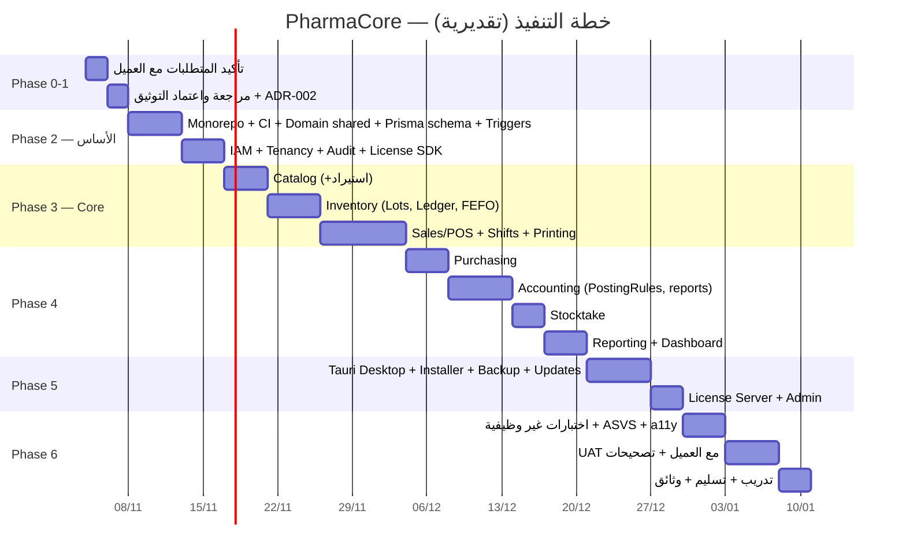

# خارطة الطريق وخطة التنفيذ (Roadmap, MVP Scope, WBS)

> **المبدأ:** البنية التحتية كاملة من الأول (Multi-tenant، Ledgers، Flags)؛ الميزات تُسلَّم Module-by-Module باختبارات. لا "كل شيء في ليلة".
> **التقديرات** بوحدة "يوم عمل مركّز" لمطور + وكيل AI. الفريق الفعلي قد يوازي المسارات.

---

## 1. نطاق MVP (الإصدار 1.0 للعميل الأول)

### داخل MVP ✅
| Module | ما يُسلَّم |
|---|---|
| Tenancy & IAM | مستأجر واحد، مواقع، مستخدمون، أدوار افتراضية، PIN، تدقيق |
| Catalog | أصناف، وحدات هرمية، باركود متعدد، بحث عربي/إنجليزي، بدائل، استيراد Excel |
| Inventory | دفعات، Ledger، FEFO، لا منتهٍ/لا سالب، تنبيهات انتهاء/نقص، حركة صنف، إتلاف، رصيد افتتاحي، موقع واحد (البنية تدعم أكثر) |
| Sales/POS | شاشة بيع كاملة بلوحة المفاتيح، نقدي/آجل/مقسم، خصم بحدود + موافقة، تعليق، مرتجع، ورديات + Z، طباعة حرارية، استرجاع مسودة |
| Purchasing | موردون، فاتورة شراء بدفعات وبونص، مرتجع، سداد، كشف حساب |
| Accounting | دليل حسابات، قيود تلقائية (PR-01..14)، مصروفات، تحصيل/سداد، ميزان، أرباح وخسائر، كشوف، أعمار ديون |
| Stocktake | جلسة كاملة/جزئية، عدّ، فروقات، ترحيل |
| Reporting | لوحة معلومات + 12 تقريراً + تصدير PDF/Excel + نشاط الموظف |
| Licensing | Ed25519، أوفلاين، Feature flags، خادم ترخيص بسيط |
| System | Installer Windows (Lite: Tauri + SQLite)، نسخ احتياطي مشفر تلقائي + استعادة، تحديثات، إعدادات، قالب فاتورة |

### خارج MVP → الإصدارات التالية ⏳
| الإصدار | الميزات |
|---|---|
| **v1.1** (بعد 1–2 شهر من التسليم) | عملات متعددة + فروق عملة، مواقع متعددة وتحويلات، اقتراح طلب شراء، إقفال فترات، تحديث أسعار جماعي، وضع تدريب، GS1 parser، جرد متعدد الأجهزة |
| **v1.2** | PostgreSQL محلي لعدة أجهزة (ترقية من Lite)، لوحة مالك PWA للقراءة، تقرير يومي واتساب/تلغرام |
| **v2.0** (SaaS) | Multi-tenant سحابي، مزامنة فروع (PowerSync)، تطبيق جوال، باقات وفوترة، API عامة |
| **v2.x** | وصفات، تأمين، تكامل موردين، AI للتنبؤ بالطلب والانتهاء، قاعدة أدوية مشتركة |

## 2. المراحل والجدول (تقديري)

**الإجمالي التقديري: ~70 يوم عمل مركّز ≈ 10–12 أسبوعاً تقويمياً** لفريق صغير مع وكلاء AI (مع التوازي قد ينخفض إلى 7–8 أسابيع). عرض عبدالكريم "شهرين" واقعي كحد أدنى للـ MVP **إن** بدأنا بعد اعتماد التوثيق مباشرة.

## 3. هيكل تقسيم العمل (WBS) — المرحلة 2 و3 بالتفصيل

### WBS-2 الأساس
| # | المهمة | المخرج | DoD |
|---|---|---|---|
| 2.1 | Monorepo (pnpm, Turborepo, tsconfig base, ESLint boundaries, Prettier, commitlint, Changesets) | يبني ويُفحص | CI أخضر |
| 2.2 | `packages/shared`: Zod schemas أساسية، types، i18n skeleton (ar) | — | اختبارات |
| 2.3 | `packages/domain/shared`: Money, Quantity, Ids (UUIDv7), DateOnly, Result, AggregateRoot, DomainEvent | — | unit 100% |
| 2.4 | `apps/api` skeleton: Nest, config, logger (pino), health, OpenAPI, global guards (stubs), UoW (Prisma tx), Outbox table + dispatcher | `/health` | integration |
| 2.5 | Prisma schema كامل (DATA-MODEL) + migrations + SQL (triggers, RLS, indexes) + seed (currencies, CoA, roles) | DB تعمل PG + SQLite | اختبارات القيود |
| 2.6 | `apps/web` skeleton: Vite, React, Tailwind RTL, shadcn, router, AppShell, StatusBar, hotkeys registry, TanStack Query + persist, OpenAPI codegen | شاشة فارغة RTL | E2E smoke |
| 2.7 | IAM: users/roles/permissions, Argon2id, JWT+refresh, PIN, lockout, AuthGuard, RbacGuard, login UI | دخول يعمل | unit+int+e2e |
| 2.8 | Tenancy: tenant/location, TenantGuard, RLS wiring, settings | — | اختبار عزل |
| 2.9 | Audit module + listeners | سجل يعمل | int |
| 2.10 | `packages/license-sdk`: verify, fingerprint (Node), store, FeaturePolicy; LicenseGuard; شاشة تفعيل | ترخيص dev | unit+e2e |

### WBS-3 Core
| # | المهمة | DoD |
|---|---|---|
| 3.1 Catalog | Item aggregate + units + barcodes + search (pg_trgm/FTS5) + import wizard + UI (قائمة/نموذج) | FR-CAT-* |
| 3.2 Inventory | Lot, StockMovement repo (append-only), FefoAllocator, balances projector, receive/issue/adjust/writeoff/opening, alerts job, UI (أرصدة/حركة/تنبيهات) | FR-INV-* |
| 3.3 Sales | SalesInvoice aggregate, Shift, PostInvoice saga (+Inventory +Accounting stub), returns, holds, numbering, Customer, credit checks, approvals, POS UI كامل، Payment dialog، Z-report، printing sidecar، draft persistence | FR-SAL-* |

(WBS-4..6 بنفس النمط — تُفصَّل عند الوصول إليها وتُحدَّث هنا.)

## 4. المخرجات لكل مرحلة (Deliverables)
| المرحلة | المخرج للعميل/الفريق |
|---|---|
| 1 | هذا التوثيق + فيديو + عرض سعر موقّع |
| 2 | Demo داخلي: دخول + ترخيص + هيكل |
| 3 | **Demo للعميل #1:** بيع كامل بدفعات وطباعة (نقطة تحقق — ملاحظات مبكرة) |
| 4 | Demo #2: دورة كاملة شراء→بيع→جرد→تقارير |
| 5 | نسخة تثبيت `.exe` تجريبية على جهاز العميل (بيانات تجريبية) |
| 6 | تشغيل فعلي + تدريب + دليل + عقد دعم |

## 5. الأدوار المقترحة في التنفيذ
| المسار | المسؤول المقترح | ملاحظة |
|---|---|---|
| Domain + API (Inventory/Sales/Accounting) | معين + وكلاء AI | الأكثر حساسية |
| Prisma/DB/Triggers | مازن | وثيقته التقنية |
| POS UI/UX + Design System | مازن (هوية) + معين | — |
| اختبارات القبول/السيناريوهات المحاسبية | عبدالكريم | محاسبة |
| سيناريوهات واقع الصيدلية + UAT | منصور | خبرة ميدانية |
| العرض/التسعير/العقد/التدريب | هلال + عمار + داوود | — |

## 6. المعالم (Milestones) وقرارات Go/No-Go
| المعلم | المعيار |
|---|---|
| M0 — اعتماد التوثيق | الفريق يوافق على SRS + ADRs (خاصة ADR-002)؛ العميل يؤكد المتطلبات ويدفع المقدم |
| M1 — الأساس جاهز | CI أخضر، DB بقيودها، دخول وترخيص يعملان |
| M2 — أول بيع | Demo بيع حقيقي بدفعات وطباعة أمام العميل |
| M3 — دورة كاملة | شراء→بيع→مرتجع→جرد→تقارير متطابقة محاسبياً (اختبارات الاتساق تمر) |
| M4 — قابل للتثبيت | `.exe` على جهاز العميل |
| M5 — Go-live | UAT موقّع؛ بيانات حقيقية؛ تدريب منجز |

## 7. المخاطر المرتبطة بالجدول
انظر `docs/10-business/RISK-REGISTER.md`. أهمها: تأخر تأكيد المتطلبات، توسّع النطاق (Scope creep)، مشاكل طابعات/أجهزة قديمة.
